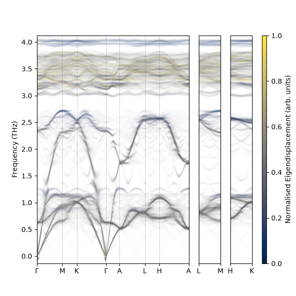

<div id="toc">

 

  <ul style="list-style: none">
    <summary>
      <h2> <pre>puppy - Phonon Unfolding and Projections</pre></h2>
    </summary>
  </ul>
</div>


`puppy` is a code for unfolding defect phonons and projecting atomic eigendisplacements onto phonon dispersion curves.

### Installation

```
git clone https://github.com/badw/puppy.git 
cd puppy 
pip install . 
```

### Examples

an example Jupyter Notebook can be found here: 


`./examples/example.ipynb`

> result for $V_{Ag}$ in AgI:

<p align="center">

</p>

### Spectral functions

The unfolded spectral function of [Ikeda *et al.*, PRB **95**, 024305 (2017)](https://journals.aps.org/prb/abstract/10.1103/PhysRevB.95.024305),

$$A(\mathbf{k},\omega) = \sum_J W_J(\mathbf{k})\,\delta(\omega-\omega_J),$$

is the unfolding weights $W_J$ placed at the supercell frequencies and broadened (Lorentzian, HWHM 0.05 THz by default).
Partial spectral functions $A^{XX'}$ for elements (or any groups of sites) sum to $A$:

```python
puppy.run_unfold(groups="elements", average_star=True)  # or groups={"near": [...], "far": [...]}
w, A, A_partial = puppy.get_spectral_function(width=0.05, partial=True)

from puppy.plotting import PuppyPlotter
pp = PuppyPlotter(puppy)
pp.plot_spectral_function(log=True)                    # total
pp.plot_spectral_function(spectral=A_partial[:, :, 1, 1], log=True)  # e.g. Ag-Ag
```

